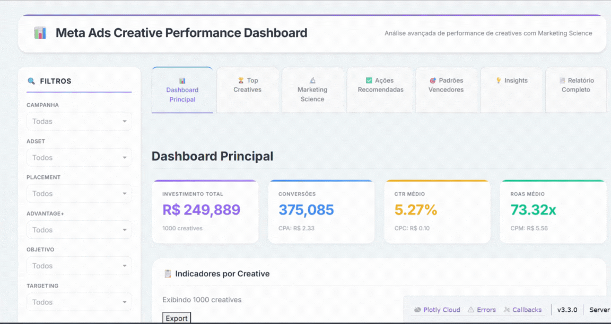

# Criativos de Meta Ads: o que se associa a um ROAS melhor

<p align="center">
  
</p>

Dashboard em Dash e um conjunto de análises para responder: quais características de um criativo (posicionamento, público, objetivo da campanha, Advantage+) andam junto com ROAS e CPA melhores, e para onde faria sentido mover verba.

## Dados

Uma amostra de 1.000 criativos com dados fictícios (nomes genéricos como `Creative_0`, `Campaign_9`): investimento em US$, impressões, alcance, frequência, cliques e conversões.

A base não tem receita. Eu simulei a receita como conversões × US$ 50, então o ROAS aqui é ilustrativo (média de 73x). O que vale são as comparações entre grupos, não o nível.

## O que tem

- KPIs do período: investimento, conversões, CTR, CPC, CPM, CPA e ROAS, com filtros por campanha, adset, posicionamento, objetivo e público.
- Fatores do ROAS: Ridge, random forest e gradient boosting, com a importância de cada variável.
- Comparação entre criativos com e sem Advantage+ Placements: diferença de médias, teste t e d de Cohen.
- Lift por posicionamento, público e objetivo: quanto cada grupo fica acima ou abaixo da média.
- Frequência × CPA, matriz de decisão (escalar, testar, pausar) e um cenário de 30 dias.
- Três geradores de relatório em HTML na pasta `scripts/`.

## Como validei

- R² em validação cruzada de 5 dobras (embaralhada, com semente fixa). A padronização fica dentro de um `Pipeline`, então ela é ajustada só nas dobras de treino.
- Os coeficientes e as importâncias são lidos de um ajuste na base inteira, que serve só para interpretar.
- `pytest` confere que a base carrega, que o ROAS do painel bate com receita ÷ investimento, que o relatório completo tem todas as seções e que o app monta o layout.

| Modelo | R² (validação cruzada) |
|---|---|
| Ridge | 0,335 |
| Random forest | 0,324 |
| Gradient boosting | 0,292 |

As variáveis explicam cerca de um terço da variação do ROAS. O modelo linear empata com os de árvore, então não há ganho em usar um modelo mais complexo aqui.

Criativos com Advantage+ Placements tiveram ROAS médio de 72,3x, contra 74,3x sem. A diferença não é significativa (p = 0,68).

## O que mudei na revisão

- O scaler era ajustado na base inteira antes da validação cruzada. Agora fica dentro do `Pipeline`.
- Duas análises tinham nome de método causal ("Difference-in-Differences" e "Causal Impact"), mas no código são comparações de médias entre grupos num corte só. Renomeei para o que elas fazem.
- Removi um módulo que não era importado por nenhum arquivo e calculava o R² no próprio treino.
- O painel mostrava R$, mas os valores da base estão em dólar.

## Limitações

- A receita é simulada, como explicado acima.
- A base é um corte só, sem antes e depois. Toda comparação entre grupos mostra associação, não efeito causal.
- O cenário de 30 dias é uma regra: supõe capturar 30% da distância entre o ROAS médio e o do quartil superior. Não é um modelo de previsão.
- Objetivo, público e posicionamento entram nos modelos com `LabelEncoder`, o que cria uma ordem que não existe. One-hot seria o certo para o Ridge.

## Como rodar

```bash
python -m venv .venv
.venv\Scripts\activate
pip install -r requirements.txt
python run_dashboard.py --open
```

O painel abre em `http://127.0.0.1:8050`. Para os relatórios e os testes:

```bash
python scripts/generate_report.py
python scripts/generate_lift_report.py
python scripts/relatorio_completo.py
pytest
```

## Estrutura

```
data/raw/                     amostra de criativos (CSV)
src/campanhas/                carga, métricas e análises
src/campanhas/dashboard/      app Dash e CSS
scripts/                      geradores dos relatórios HTML
reports/                      saída dos relatórios (fora do git)
tests/                        testes de consistência e do app
docs/                         GIF de demonstração
run_dashboard.py              sobe o painel
```
